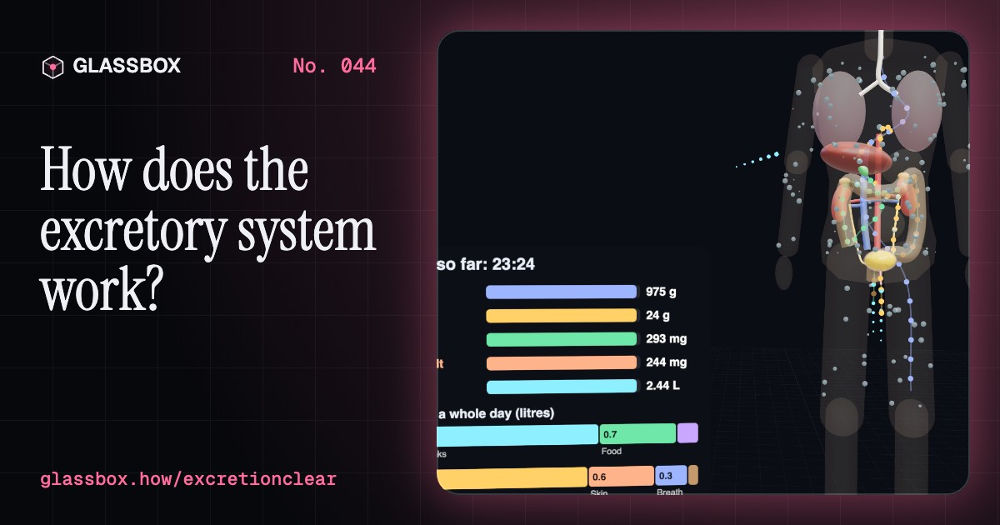
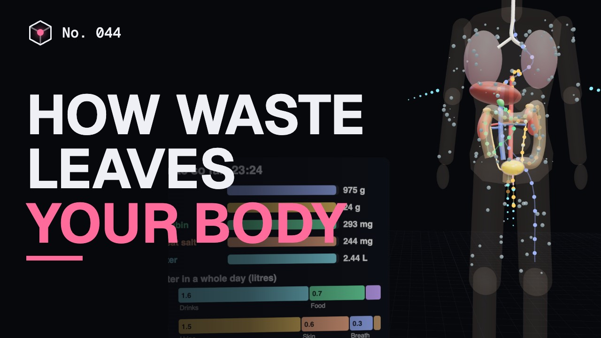
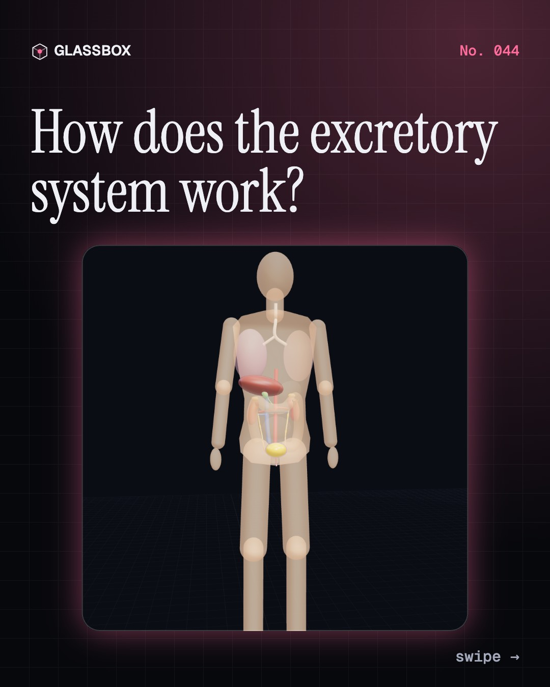
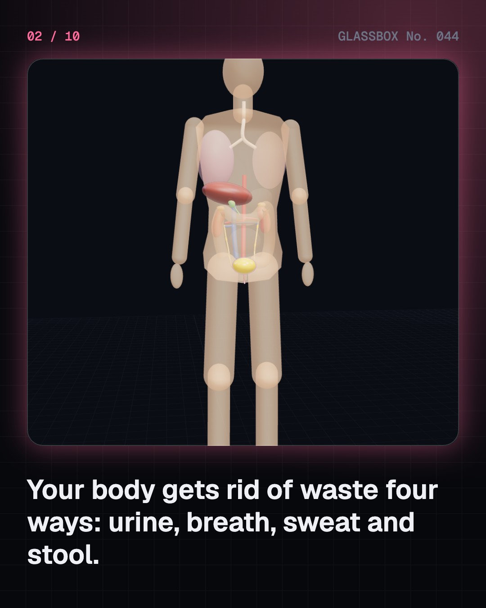
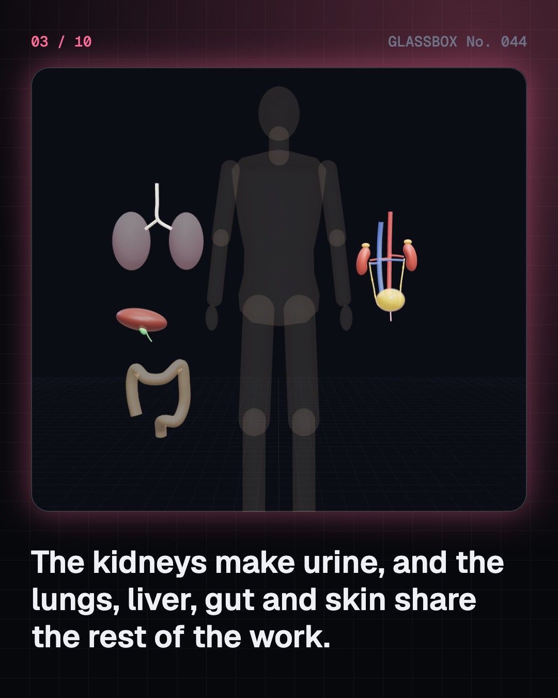
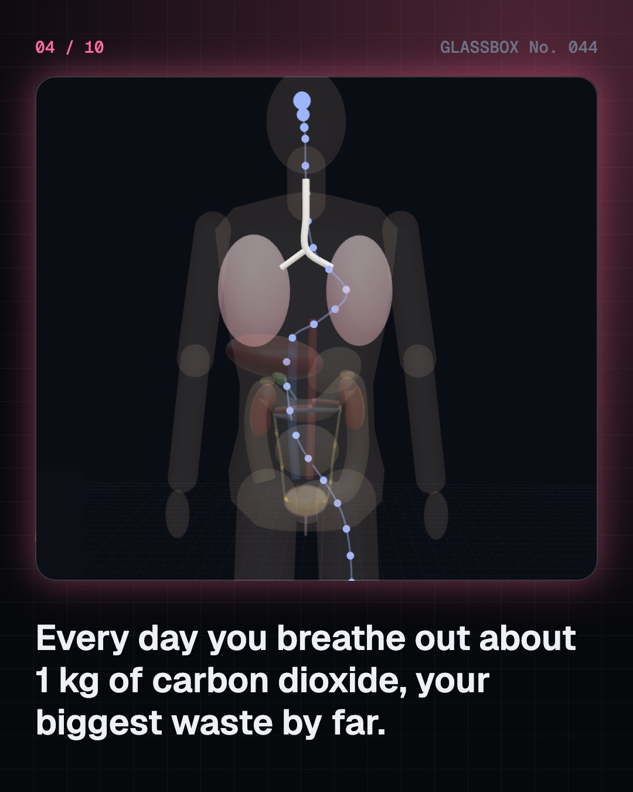

<!-- glassbox:start -->
<!-- Generated from glassbox.json by the Glassbox hub (npm run readme -- excretionclear). Edit glassbox.json, not this block. -->
<p align="center"><a href="https://glassbox-production-fd52.up.railway.app/e/excretionclear/"></a></p>

<h1 align="center">ExcretionClear</h1>

<p align="center"><b>How does the excretory system work?</b><br>Every day you get rid of about 1 kg of carbon dioxide, a litre and a half of urine and a surprising amount of sweat. See all four ways out in a see-through body, watch the liver lock toxic ammonia into urea, fill a bladder until the brain says go, and swap sweat for urine on a hot day.</p>

<p align="center"><a href="https://glassbox-production-fd52.up.railway.app/excretionclear/"><b>▶ Play with it</b></a> &nbsp;·&nbsp; <a href="https://glassbox-production-fd52.up.railway.app/e/excretionclear/">Read the 60-second explainer</a> &nbsp;·&nbsp; <a href="https://glassbox-production-fd52.up.railway.app/excretionclear/glassbox/reel.mp4">Watch the 40-second video</a></p>

<p align="center">
  <a href="https://glassbox-production-fd52.up.railway.app/e/excretionclear/"></a>
  <a href="https://glassbox-production-fd52.up.railway.app/e/excretionclear/"></a>
  <a href="LICENSE"></a>
  <a href="LICENSE-CONTENT.md"></a>
  <a href="#privacy"></a>
</p>

## In 60 seconds

1. **Four ways out.** The body gets rid of waste four ways: urine from the kidneys, carbon dioxide from the lungs, sweat from the skin and stool carrying bile from the liver. Kidneys, ureters, bladder and urethra form the urinary tract; the urethra is about 4 cm in women and about 20 cm in men.
2. **What you throw away every day.** About 1 kg of carbon dioxide, 20–35 g of urea, about 0.3 g of bilirubin from old red blood cells, and about 2.5 litres of water split between urine, skin, breath and stool.
3. **Turning poison into urea.** Protein leaves nitrogen behind as toxic ammonia. The liver's urea cycle joins it with carbon dioxide into harmless urea, about 3 ATP a molecule. Fish just wash ammonia away through their gills; birds make a dry paste of uric acid.
4. **Hold on.** The bladder stretches while pressure stays low. Stretch sensors report at about 150–300 mL, and the cortex holds the brainstem's go switch until you are ready. Cold, coffee and nerves make you go sooner, for different reasons.
5. **Sweat or urine.** Heat and exercise send water out as sweat, so ADH rises and urine turns small and dark. Cold does the opposite. Urine can't carry the day's waste in less than about half a litre, so if sweat takes more than you drink, you dry out.
6. **Keeping it healthy.** About half of women get a bladder infection at some point. Kidney stones, dehydration and ORS, bedwetting (normal at 5), an enlarged prostate in older men and dialysis when kidneys fail. For your own body, see a doctor.

## Words worth knowing

| Term | Meaning |
|---|---|
| **Excretion** | Getting rid of waste your own cells made, such as carbon dioxide, urea and extra salt. |
| **Urinary tract** | Kidneys, ureters, bladder and urethra: the system that makes, stores and releases urine. |
| **Urea** | A harmless molecule the liver makes from toxic ammonia so nitrogen can leave in urine. |
| **Urea cycle** | A loop of reactions in liver cells that joins ammonia and carbon dioxide into urea. |
| **Bilirubin** | Yellow pigment from old red blood cells, sent out in bile; it colours stool and urine. |
| **Detrusor** | The muscle wall of the bladder: relaxed while filling, squeezing to empty. |
| **Sphincter** | A ring of muscle that closes a tube. The bladder has an automatic one and one you control. |
| **ADH** | Antidiuretic hormone from the pituitary; it tells the kidneys to keep water. |
| **ORS** | Oral rehydration salts: salt and sugar that carry water back into the body during diarrhoea. |

## A short history

**4,500 years from covered drains in the Indus cities to urea made in a flask, a light inside the bladder and a salt-and-sugar drink that saves millions.**

- **2500 BCE** · Toilets and covered drains in the Indus cities (Harappan builders, Mohenjo-daro and Harappa (today Pakistan), Lothal and Dholavira (today India))
- **1200** · The urine flask becomes the doctor's badge (Gilles de Corbeil and the Salerno school, Salerno, Italy, and Paris, France)
- **1614** · Weighing the invisible loss (Santorio Santorio, Padua, Italy)
- **1828** · Urea made in a flask (Friedrich Wöhler, Berlin, Germany)
- **1854** · Cholera and the Broad Street pump (John Snow, London, England)
- **1877** · A light inside the bladder (Maximilian Nitze and Josef Leiter, Dresden, Germany, then Vienna, Austria)
- **1932** · The urea cycle (Hans Krebs and Kurt Henseleit, Freiburg, Germany)
- **1971** · ORS in the refugee camps (Dilip Mahalanabis, Bangaon, West Bengal, India)

The full story, with 29 moments, charts, people and 28 sources: [glassbox.how/e/excretionclear/history](https://glassbox-production-fd52.up.railway.app/e/excretionclear/history/). The data lives in [`history.json`](history.json).

## Video and slides

Made with the Glassbox studio from this box's storyboard (`window.glassbox.director`). Free to reuse under CC BY 4.0.

<a href="https://glassbox-production-fd52.up.railway.app/excretionclear/glassbox/video.mp4"></a>

<p><a href="glassbox/slide-1.jpg"></a> <a href="glassbox/slide-2.jpg"></a> <a href="glassbox/slide-3.jpg"></a> <a href="glassbox/slide-4.jpg"></a></p>

| File | What | Size |
|---|---|---|
| [`glassbox/reel.mp4`](https://glassbox-production-fd52.up.railway.app/excretionclear/glassbox/reel.mp4) | Reel / Short, with captions and soundtrack | 1080×1920 |
| [`glassbox/video.mp4`](https://glassbox-production-fd52.up.railway.app/excretionclear/glassbox/video.mp4) | YouTube video, with captions and soundtrack | 1920×1080 |
| `glassbox/slide-1…10.jpg` | Instagram carousel | 1080×1350 |
| `glassbox/thumb.jpg` | YouTube thumbnail | 1280×720 |
| `glassbox/cover.jpg` | Share card and repo social preview | 1200×630 |
| [`glassbox/history-reel.mp4`](https://glassbox-production-fd52.up.railway.app/excretionclear/glassbox/history-reel.mp4) | “History in 10 moments” Reel / Short | 1080×1920 |
| `glassbox/history-slide-*.jpg` | History carousel | 1080×1350 |
| `glassbox/post.json` | Post copy and schedule used by the publish kit | |

## Privacy

This box has no accounts and no ads, and it ships its own fonts and libraries. When you run it yourself it sends nothing anywhere. On glassbox.how, the site's `/bar.js` also loads Glassbox's analytics: **Google Analytics** to count visits (it asks first in the EU, UK and Switzerland, and stays off when your browser sends Global Privacy Control or Do Not Track) and **ClickTrust** to detect bots.

It remembers a few things **in your own browser only**, and never sends them anywhere:

| Browser storage key | What it holds |
|---|---|
| `excretionclear.v1` | Which chapters you have opened, your best quiz scores, and sound on or off. |

Exactly what each one sees is at [glassbox.how/privacy](https://glassbox-production-fd52.up.railway.app/privacy/).

## Licences

- **Code:** [MIT](LICENSE). Use it, change it, ship it.
- **Explanations, text, images and videos** (`glassbox.json`, `glassbox/`): [CC BY 4.0](LICENSE-CONTENT.md). Credit “Glassbox, glassbox.how/e/excretionclear”.
- **Third-party parts** keep their own licences: [three.js](https://threejs.org) (MIT), [Geist, Instrument Serif](https://openfontlicense.org) (SIL OFL 1.1).
- The Glassbox name and logo aren't covered by either licence. See the [terms](https://glassbox-production-fd52.up.railway.app/terms/).

Found a mistake? [Open an issue](https://github.com/bdeeps/excretionclear/issues). Corrections happen in public.
<!-- glassbox:end -->

## Run it

It's plain HTML, CSS and JavaScript. No build step and no dependencies. Run locally, it contacts no other website.

```bash
python3 -m http.server 8000
```

Three.js and the fonts ship in `vendor/` and `fonts/`, so it also works offline.

Then open http://localhost:8000.

## How it's built

| File | What |
|---|---|
| `index.html`, `css/app.css` | The page and its styles |
| `js/app.js`, `js/stage.js`, `js/ui.js`, `js/kit.js` | The shared Glassbox 3D engine: chapters, 3D stage, controls, quiz, video director |
| `js/chapters/*.js` | One file per chapter: the 3D model, controls, text, key terms, quiz and video scenes |
| `js/excrete.js` | The ghosted body with the urinary tract (kidneys, ureters, bladder, female and male urethra) and the other exits (lungs, liver and gallbladder, large intestine, skin), the daily waste and water budget numbers, the urine colour chart and helpers |
| `glassbox.json` | Title, question, explainer beats, key terms, browser storage and credits shown on glassbox.how |
| `reel` in each chapter | The storyboard the Glassbox studio records into short videos |
| `glassbox/` | The published video, slides, thumbnail and post copy |
| `fonts/`, `vendor/three/` | Self-hosted Geist and Instrument Serif (SIL OFL 1.1) and three.js (MIT) |
